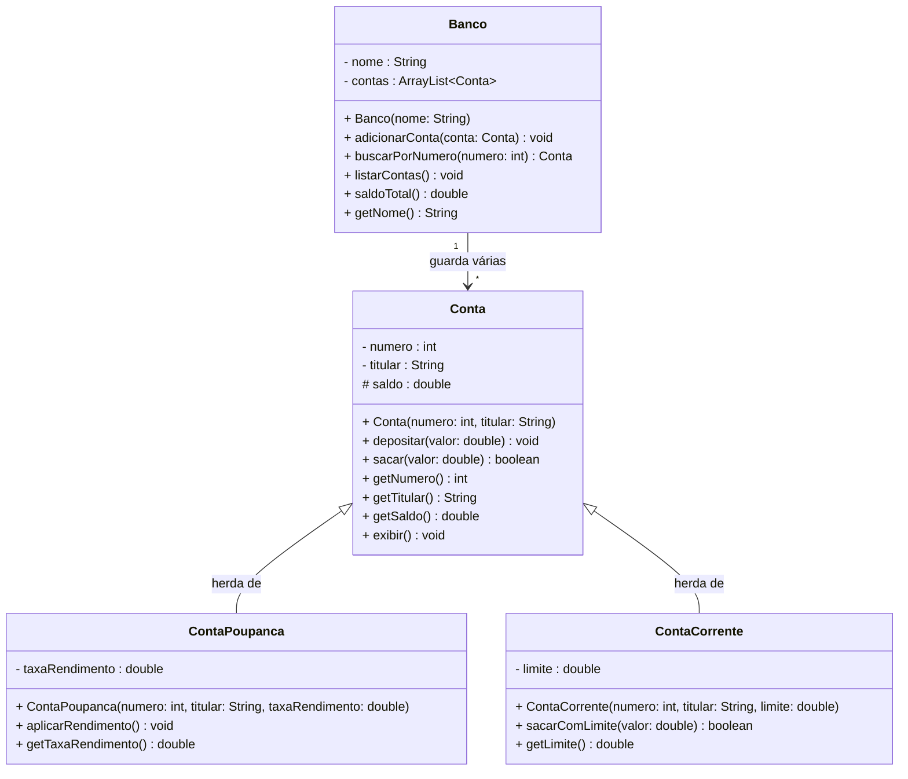

# Sistema Bancário — Avaliação Prática 2 (AP2)

Este repositório contém a implementação completa da **Avaliação Prática 2 (AP2)** da disciplina de **Programação Orientada a Objetos (POO)**. O projeto consiste em um sistema bancário modelado estritamente a partir do diagrama UML fornecido, com foco central nos pilares de **Encapsulamento** e **Herança**, utilizando **Java (JDK 21)**.

---

## 📌 Sumário
- [1. Matriz de Atendimento aos Critérios de Avaliação](#1-matriz-de-atendimento-aos-critérios-de-avaliação)
- [2. Diagrama de Classes UML](#2-diagrama-de-classes-uml)
- [3. Estrutura do Projeto e Explicação das Classes](#3-estrutura-do-projeto-e-explicação-das-classes)
  - [3.1 Classe Base `Conta`](#31-classe-base-conta)
  - [3.2 Subclasse `ContaPoupanca`](#32-subclasse-contapoupanca)
  - [3.3 Subclasse `ContaCorrente`](#33-subclasse-contacorrente)
  - [3.4 Classe Gerenciadora `Banco`](#34-classe-gerenciadora-banco)
  - [3.5 Classe Executável `Main`](#35-classe-executável-main)
- [4. Demonstração dos 8 Passos da `Main`](#4-demonstração-dos-8-passos-da-main)
- [5. Guia para Apresentação Oral em Grupo](#5-guia-para-apresentação-oral-em-grupo)
- [6. Como Executar o Projeto](#6-como-executar-o-projeto)

---

## 1. Matriz de Atendimento aos Critérios de Avaliação

Abaixo apresentamos a comprovação de conformidade com todos os itens da rubrica de avaliação (Parte 5 do enunciado):

| Critério de Avaliação | Peso | Status | Onde e Como foi Atendido no Código |
| :--- | :---: | :---: | :--- |
| **Herança correta** | 25% | **100% Atendido** | • Subclasses utilizam `extends Conta`.<br>• Construtores invocam `super(numero, titular)` na primeira linha.<br>• Nenhum atributo da classe mãe (`numero`, `titular`, `saldo`) foi redeclarado nas classes filhas. |
| **Encapsulamento** | 25% | **100% Atendido** | • Atributos `numero`, `titular`, `taxaRendimento`, `limite`, `nome` e `contas` são `private`.<br>• Atributo `saldo` é `protected` para acesso controlado direto pelas subclasses filhas.<br>• `numero` e `titular` não possuem setters (imutáveis após a criação).<br>• `saldo` só é modificado via operações válidas (`depositar`, `sacar`, `aplicarRendimento`, `sacarComLimite`).<br>• Validações estritas em depósitos e saques impedindo valores $\le 0$. |
| **Fidelidade ao diagrama** | 20% | **100% Atendido** | • Nomes de classes, atributos, tipos e métodos seguem exatamente a especificação do diagrama UML.<br>• Visibilidades idênticas: `-` para private, `#` para protected e `+` para public.<br>• Respeitada a orientação de não incluir polimorfismo, interfaces ou classes abstratas desnecessárias. |
| **`Banco` com `ArrayList`** | 15% | **100% Atendido** | • Gerenciamento através de `ArrayList<Conta> contas`.<br>• `adicionarConta(conta)` insere na lista.<br>• `buscarPorNumero(numero)` percorre a coleção e retorna o objeto ou `null`.<br>• `listarContas()` percorre a coleção e invoca `exibir()`.<br>• `saldoTotal()` acumula os saldos de todas as contas cadastradas. |
| **`main` com os 8 passos** | 10% | **100% Atendido** | • A classe `Main.java` executa sequencialmente todos os 8 passos exigidos no enunciado com saídas claras e didáticas no console. |
| **Apresentação do Grupo** | 5% | **100% Preparado** | • Incluído roteiro completo de perguntas e respostas para suporte oral a todos os integrantes do grupo. |

---

## 2. Diagrama de Classes UML

O sistema foi modelado exatamente de acordo com o diagrama UML da AP2:



---

## 3. Estrutura do Projeto e Explicação das Classes

O projeto é composto por 5 arquivos `.java` no pacote `ap2`:

```
poo ap2/
├── Conta.java
├── ContaPoupanca.java
├── ContaCorrente.java
├── Banco.java
├── Main.java
└── README.md
```

### 3.1 Classe Base `Conta` (`Conta.java`)
É a classe mãe (superclasse) que representa a conta bancária genérica.
- **Atributos**:
  - `private int numero`: número identificador da conta (imutável após criação).
  - `private String titular`: nome do correntista (imutável após criação).
  - `protected double saldo`: valor monetário disponível. Declarado como `protected` para que apenas a classe `Conta` e suas classes filhas (`ContaPoupanca` e `ContaCorrente`) possam manipulá-lo diretamente, protegendo contra acessos indevidos de fora da hierarquia.
- **Construtor**:
  - `public Conta(int numero, String titular)`: inicializa o número e o titular passados por parâmetro e define o `saldo` inicial estritamente como `0.0`.
- **Encapsulamento**:
  - Possui apenas getters (`getNumero()`, `getTitular()`, `getSaldo()`). Não possui setters para garantir que o saldo e dados cadastrais não sejam alterados arbitrariamente.
- **Regras de Negócio e Métodos**:
  - `depositar(double valor)`: valida se `valor > 0`. Apenas se verdadeiro, adiciona ao `saldo`. Caso contrário, exibe aviso e não altera o estado do objeto.
  - `sacar(double valor)`: valida se `valor > 0` e se `valor <= this.saldo`. Em caso positivo, debita do saldo e retorna `true`. Se o saldo for insuficiente ou o valor inválido, mantém o saldo inalterado e retorna `false`.
  - `exibir()`: imprime na saída padrão os dados formatados da conta (`numero`, `titular`, `saldo`).

---

### 3.2 Subclasse `ContaPoupanca` (`ContaPoupanca.java`)
Especialização da classe `Conta` para operações de poupança com rendimento.
- **Herança**:
  - Declarada com `public class ContaPoupanca extends Conta`.
  - Herda todos os atributos e métodos de `Conta`, não os declarando novamente.
- **Atributo Específico**:
  - `private double taxaRendimento`: percentual de rendimento (por exemplo, `0.05` para 5%).
- **Construtor**:
  - `public ContaPoupanca(int numero, String titular, double taxaRendimento)`: repassa `numero` e `titular` para a superclasse via `super(numero, titular)` e atribui `this.taxaRendimento = taxaRendimento`.
- **Métodos**:
  - `aplicarRendimento()`: calcula o rendimento e incrementa o saldo diretamente:
    ```java
    this.saldo += this.saldo * this.taxaRendimento;
    ```
    Isso é possível porque `saldo` possui modificador de visibilidade `protected`.
  - `getTaxaRendimento()`: getter para consulta da taxa configurada.

---

### 3.3 Subclasse `ContaCorrente` (`ContaCorrente.java`)
Especialização da classe `Conta` que incorpora o conceito de limite de cheque especial.
- **Herança**:
  - Declarada com `public class ContaCorrente extends Conta`.
- **Atributo Específico**:
  - `private double limite`: valor do crédito adicional disponível para saques além do saldo em conta.
- **Construtor**:
  - `public ContaCorrente(int numero, String titular, double limite)`: repassa `numero` e `titular` para a superclasse via `super(numero, titular)` e armazena o limite em `this.limite`.
- **Métodos**:
  - `sacarComLimite(double valor)`: implementa a regra do cheque especial. Permite saques desde que `valor > 0` e `valor <= (this.saldo + this.limite)`. Se atendido, subtrai o valor do saldo (que pode ficar negativo) e retorna `true`. Caso o valor supere a soma de saldo e limite, retorna `false` sem alterar o saldo.
  - `getLimite()`: getter para consulta do limite de crédito.

---

### 3.4 Classe Gerenciadora `Banco` (`Banco.java`)
Representa a instituição bancária e demonstra a relação de **associação** ("o banco guarda várias contas").
- **Atributos**:
  - `private String nome`: nome do banco.
  - `private ArrayList<Conta> contas`: lista dinâmica que armazena os objetos do tipo `Conta`.
- **Polimorfismo e Herança na Coleção**:
  - Graças à herança ("é um tipo de"), tanto instâncias de `Conta` quanto de `ContaPoupanca` e `ContaCorrente` são aceitas naturalmente na lista `ArrayList<Conta>`.
- **Métodos**:
  - `adicionarConta(Conta conta)`: adiciona o objeto à lista interna via `.add(conta)`.
  - `buscarPorNumero(int numero)`: percorre a lista através de um laço `for-each` comparando `conta.getNumero() == numero`. Retorna a referência da conta encontrada ou `null` caso não exista.
  - `listarContas()`: itera por todas as contas da coleção e chama `conta.exibir()` para cada uma.
  - `saldoTotal()`: itera pela lista acumulando o retorno de `conta.getSaldo()` e devolve a soma monetária de todas as contas sob custódia.
  - `getNome()`: getter para o nome do banco.

---

### 3.5 Classe Executável `Main` (`Main.java`)
Ponto de entrada do programa (`public static void main(String[] args)`), responsável por instanciar os objetos e comprovar o funcionamento de cada regra de negócio especificada.

---

## 4. Demonstração dos 8 Passos da `Main`

A `Main.java` implementa e imprime de maneira estruturada a verificação de cada um dos 8 passos solicitados:

1. **Criar um Banco**:
   - Cria o objeto `banco = new Banco("Banco Central AP2")`.
2. **Criar uma conta de cada tipo**:
   - `Conta contaComum = new Conta(101, "Alice");`
   - `ContaPoupanca contaPoupanca = new ContaPoupanca(202, "Bruno", 0.05);` (taxa de 5%)
   - `ContaCorrente contaCorrente = new ContaCorrente(303, "Carla", 500.0);` (limite de R$ 500,00)
   - Exibe o estado inicial de cada uma (todas com saldo R$ 0,00).
3. **Adicionar as três contas ao Banco**:
   - Invoca `banco.adicionarConta(...)` para as três contas criadas.
4. **Fazer alguns depósitos e saques**:
   - Depósito de R$ 1.000,00 e saque de R$ 300,00 na conta comum (saldo vai para R$ 700,00).
   - Depósito de R$ 500,00 na conta poupança.
   - Depósito de R$ 200,00 na conta corrente.
5. **Mostrar um saque que falha por saldo insuficiente**:
   - Tentativa de sacar R$ 1.500,00 da conta comum (cujo saldo é R$ 700,00).
   - Demonstração de que o método retorna `false` e o saldo permanece intacto em R$ 700,00.
6. **Aplicar rendimento na poupança e mostrar o saldo antes e depois**:
   - Saldo antes: R$ 500,00.
   - Aplicação de 5% de taxa (`0.05`): $500{,}00 + (500{,}00 \times 0{,}05) = 525{,}00$.
   - Saldo depois: R$ 525,00.
7. **Sacar usando o limite na conta corrente (saldo negativo)**:
   - Saldo atual: R$ 200,00; Limite: R$ 500,00 (total disponível: R$ 700,00).
   - Saque de R$ 600,00 via `sacarComLimite(600.0)`.
   - Saque aprovado (`true`) e saldo resultante: **-R$ 400,00** (dentro do limite contratado).
   - Tentativa de novo saque de R$ 200,00: como o saldo é -R$ 400,00 e o limite é R$ 500,00, resta apenas R$ 100,00 disponível. O saque retorna `false` e o saldo se mantém em -R$ 400,00.
8. **Listar todas as contas e imprimir o saldo total do banco**:
   - `banco.listarContas()` exibe os dados atualizados das 3 contas.
   - `banco.saldoTotal()` calcula a soma: $700{,}00 + 525{,}00 + (-400{,}00) = 825{,}00$.
   - Imprime `Saldo total em custódia no banco: R$ 825,00`.

### Saída Real do Terminal:
```text
==================================================
      SISTEMA BANCÁRIO - DEMONSTRAÇÃO AP2         
==================================================

--- Passo 1: Criando o Banco ---
Banco criado com sucesso: Banco Central AP2

--- Passo 2: Criando uma conta de cada tipo ---
Contas criadas inicialmente (saldo inicial = R$ 0.00):
Conta: 101 | Titular: Alice      | Saldo: R$     0,00
Conta: 202 | Titular: Bruno      | Saldo: R$     0,00
Conta: 303 | Titular: Carla      | Saldo: R$     0,00

--- Passo 3: Adicionando as três contas ao Banco ---
Todas as contas foram adicionadas ao banco.

--- Passo 4: Realizando depósitos e saques com sucesso ---
-> Depositando R$ 1000.00 na conta comum de Alice
-> Sacando R$ 300.00 da conta comum de Alice
Saque realizado? true | Saldo atual: R$ 700.0
-> Depositando R$ 500.00 na conta poupança de Bruno
-> Depositando R$ 200.00 na conta corrente de Carla

--- Passo 5: Demonstrando saque que falha por saldo insuficiente ---
Saldo atual da conta comum (Alice): R$ 700.0
Tentando sacar R$ 1500.00 (valor maior que o saldo)...
Saque aprovado? false (false esperado)
Saldo após tentativa com falha: R$ 700.0 (saldo intacto)

--- Passo 6: Aplicando rendimento na Conta Poupança ---
Taxa de rendimento: 5.0%
Saldo ANTES do rendimento: R$ 500.0
Saldo DEPOIS do rendimento: R$ 525.0

--- Passo 7: Sacando usando o limite na Conta Corrente ---
Saldo atual: R$ 200.0 | Limite disponível: R$ 500.0
Tentando sacar R$ 600.00 com limite (disponível: saldo + limite = R$ 700.00)...
Saque com limite aprovado? true
Saldo resultante: R$ -400.0 (saldo negativo dentro do limite)

Tentando saque excedendo o limite (tentando sacar mais R$ 200.00):
Saque excedendo limite aprovado? false (false esperado)
Saldo final da conta corrente: R$ -400.0

--- Verificação Adicional: Busca de conta por número ---
Buscando conta nº 202: Bruno
Buscando conta nº 999: null (Correto, conta não existe)

--- Passo 8: Listando todas as contas e calculando saldo total ---
Lista de contas registradas no banco:
Conta: 101 | Titular: Alice      | Saldo: R$   700,00
Conta: 202 | Titular: Bruno      | Saldo: R$   525,00
Conta: 303 | Titular: Carla      | Saldo: R$  -400,00
--------------------------------------------------
Saldo total em custódia no banco: R$ 825,00
==================================================
     TODOS OS 8 PASSOS CONCLUÍDOS COM SUCESSO!    
==================================================
```

---

## 5. Guia para Apresentação Oral em Grupo

Como o professor destacou no enunciado: *"Todos os integrantes apresentam. Na apresentação eu posso perguntar sobre qualquer parte do código a qualquer integrante"*.

Abaixo estão as perguntas fundamentais que o professor pode fazer e como respondê-las com clareza:

### P1: "Por que o atributo `saldo` é `protected` e não `private` ou `public`?"
> **Resposta**: "O `saldo` é `protected` porque precisamos proteger esse valor de acessos externos gerais (encapsulamento), mas ao mesmo tempo permitir que as subclasses filhas (`ContaPoupanca` e `ContaCorrente`) possam acessá-lo e modificá-lo diretamente ao aplicar rendimento ou ao sacar com cheque especial. Se fosse `private`, as filhas não conseguiriam alterar o saldo diretamente. Se fosse `public`, qualquer parte do código poderia burlar as regras de depósito e saque."

### P2: "Por que não criamos setters para `numero` e `titular` na classe `Conta`?"
> **Resposta**: "Porque os requisitos de negócio e o encapsulamento exigem que o número da conta e o titular sejam definidos uma única vez, no momento da abertura da conta através do construtor, permanecendo imutáveis depois disso. Não criar setters garante essa integridade."

### P3: "Por que `ContaPoupanca` e `ContaCorrente` não têm os atributos `numero`, `titular` e `saldo` declarados dentro delas?"
> **Resposta**: "Porque elas herdam esses atributos da classe mãe `Conta` através do `extends Conta`. Declarar novamente esses atributos nas subclasses seria um erro grave de duplicação de estado, ocultando os atributos herdados e quebrando o princípio de herança."

### P4: "Qual é a função da instrução `super(numero, titular)` nos construtores das filhas?"
> **Resposta**: "Em Java, o construtor da superclasse deve ser executado para inicializar o estado herdado. Como a classe `Conta` não tem um construtor vazio padrão, as classes filhas são obrigadas a chamar explicitamente `super(numero, titular)` na primeira linha de seus próprios construtores, repassando esses dados para a classe mãe."

### P5: "Como o `ArrayList<Conta>` no `Banco` consegue armazenar `ContaPoupanca` e `ContaCorrente` sem erro?"
> **Resposta**: "Isso acontece devido ao princípio de herança ('é um tipo de'). Como `ContaPoupanca` e `ContaCorrente` estendem `Conta`, qualquer objeto dessas subclasses é considerado uma instância válida de `Conta` pelo compilador, podendo ser adicionado à lista polimorficamente."

### P6: "Como foi implementado o método `buscarPorNumero`?"
> **Resposta**: "Utilizamos um laço `for-each` percorrendo o `ArrayList<Conta> contas`. Para cada conta, comparamos se `conta.getNumero() == numero`. Se encontrarmos a conta, ela é retornada imediatamente. Se percorrermos toda a lista sem encontrar, retornamos `null`."

---

## 6. Como Executar o Projeto

### Opção 1: Pelo IntelliJ IDEA (Recomendado)
1. Abra o IntelliJ IDEA.
2. Abra a pasta do projeto (`poo ap2`).
3. Certifique-se de que o SDK configurado no projeto é o **Java 21** (ou superior) em `File > Project Structure > Project > SDK`.
4. Abra o arquivo `Main.java`.
5. Clique no ícone verde de **Run** (Play) ao lado da declaração do método `main` ou pressione `Shift + F10`.

### Opção 2: Pelo Terminal / Linha de Comando (PowerShell / CMD)
Na pasta raiz do projeto (`c:\Users\milen\Desktop\poo ap2`):

```powershell
# 1. Compila todas as classes gerando a estrutura de pacotes:
javac -d . *.java

# 2. Executa a classe Main pelo pacote ap2:
java -cp . ap2.Main
```

---
*Projeto desenvolvido rigorosamente em conformidade com as diretrizes da AP2.*

